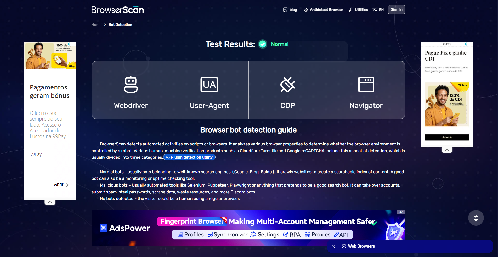
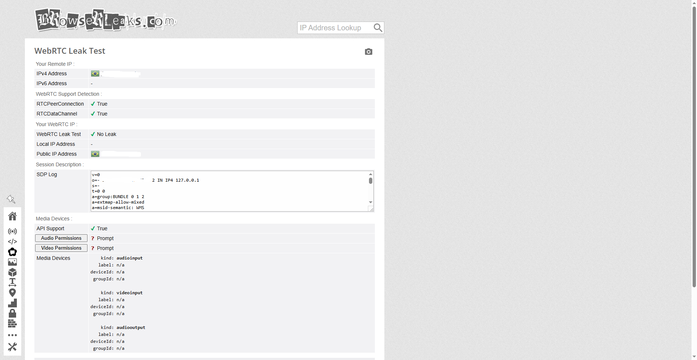

# IntelliScraper

Browser automation built on Playwright with stealth anti-detection baked in. No configuration required to get started.

```python
import asyncio
from intelliscraper import Scraper

async def main():
    async with Scraper() as scraper:
        await scraper.goto("https://example.com")
        print(await scraper.get_title())

asyncio.run(main())
```

---

## 🚀 Installation

```bash
git clone https://github.com/CarlosMarchetti/IntelliScraper.git
cd IntelliScraper
pip install -r requirements.txt
playwright install chromium
```

Copy `.env.example` to `.env` and adjust if needed — defaults work out of the box.

---

## 🧪 Anti-Detection Tests

Real-world fingerprint tests confirm that IntelliScraper behaves like a regular browser.

### BrowserScan



### WebRTC Leak Test




### What this means

* No WebDriver detection flags
* No WebRTC IP leaks
* Clean browser fingerprint
* Consistent JS + network identity

> ⚠️ No tool is truly "undetectable" forever — but this gets very close under real-world conditions.


You can also verify stealth behavior programmatically:

```bash
python examples/08_stealth_check.py

---

## 📦 Examples

The [`examples/`](examples/) folder contains ready-to-run scripts covering common scraping scenarios:

```
examples/
├── 01_basic.py               # basic navigation and page loading
├── 02_form.py                # form filling and submission
├── 03_extract_list.py        # extracting lists of data from pages
├── 04_session.py             # session handling (login persistence)
├── 05_intercept.py           # intercepting network/API responses
├── 06_proxy.py               # using proxies
├── 07_amazon_to_shopify.py   # real-world scraping example (ecommerce)
├── 08_stealth_check.py       # anti-detection / fingerprint validation
```

Run any example:

```bash
python examples/01_basic.py
```

Each script is self-contained and demonstrates a specific feature of IntelliScraper.

---

## ⚙️ Usage

### Navigation

```python
async with Scraper(headless=False) as scraper:
    await scraper.goto("https://example.com")
    await scraper.goto("https://example.com", wait_until="networkidle")
```

### Extracting data

```python
title    = await scraper.get_text("h1")
href     = await scraper.get_attribute("a.primary", "href")

quotes   = await scraper.get_texts(".quote .text")
hrefs    = await scraper.get_attributes("a", "href")

html     = await scraper.get_html()
soup     = await scraper.get_soup()
metadata = soup.extract_metadata()
```

---

## 🛡️ Anti-detection

Every session automatically applies:

* `navigator.webdriver` spoofed
* Playwright/Selenium traces removed
* Realistic plugins & MIME types
* `window.chrome.runtime` injected
* Canvas fingerprint noise
* WebGL vendor spoofing
* Network timing spoofing
* Header consistency (HTTP + JS)

---

## ⚙️ Configuration

| Variable    | Default | Description    |
| ----------- | ------- | -------------- |
| HEADLESS    | false   | Run without UI |
| TIMEOUT     | 30000   | Timeout (ms)   |
| MAX_RETRIES | 3       | Retry attempts |
| PROXY_URL   | —       | Proxy          |
| LOG_LEVEL   | WARNING | Logging        |

---

## 📄 License

MIT
